<p align="center">
  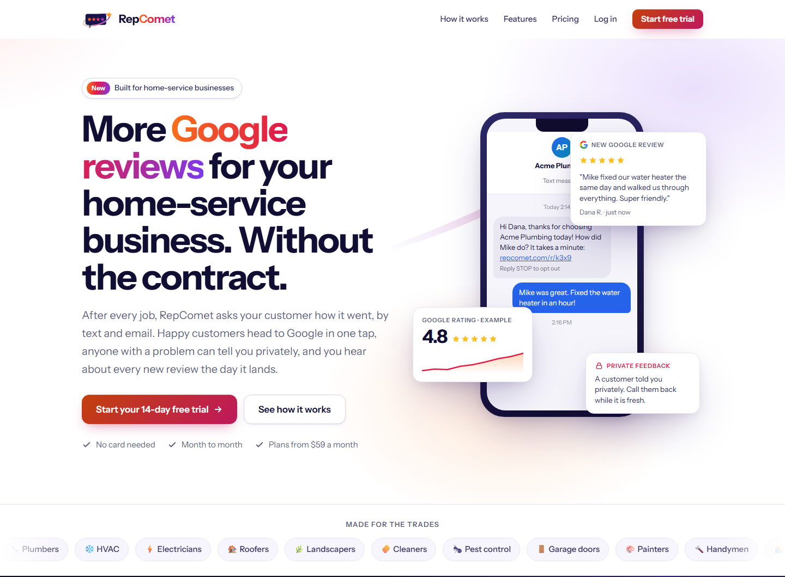
</p>

<h1 align="center">RepComet: Case Study</h1>

<p align="center">
  <b>More Google reviews for home-service businesses, without gating, gimmicks or a contract.</b><br>
  Laravel 13 · PHP 8.4 · Filament 5 · MySQL 8 · Redis + Horizon · Stripe (Cashier) · Google Places · Claude
</p>

---

Plumbers, roofers, fence builders and cleaners live and die by their Google rating, but the tools that help them get
reviews have two problems. The big platforms sell year-long contracts at prices a two-truck business cannot justify.
And the cheapest trick in the category, "review gating" (asking happy customers for a Google review and steering
unhappy ones somewhere else), breaks Google's rules and US consumer protection law, and gets reviews removed.

RepComet asks **every** customer the same way, after every job: one page, two equal buttons, "Leave a Google review"
or "Tell us privately". Happy customers reach Google in one tap, unhappy ones reach the owner while there is still
time to fix it, and nobody is filtered out. Published prices, month to month.

This repository is a **portfolio case study**: a public overview of the product, architecture and engineering. The
full application source is private and available to reviewers on request.

> **Status:** live in production at [repcomet.com](https://repcomet.com). It is in early access while the first
> businesses are set up by hand; public sign-up opens soon. Screenshots below are from the staging demo account
> ("Northside Plumbing"), with demo data only.

---

## AI in RepComet

RepComet uses AI where it saves a small business owner real time, and keeps a person in charge of everything that
goes public. Two features use a large language model (Anthropic's Claude), behind one small, testable seam.

| Feature | What it does | Who sees the output |
|---|---|---|
| **AI reply drafts** | Writes a reply to a Google review in the business's voice: thanks the reviewer, and for a review of 3 stars or fewer, apologises for the specific problem and invites them to get in touch. | The owner only. They edit it, copy it and post it on Google themselves. |
| **AI review insights** | Reads the last 90 days of Google reviews and private feedback and returns a summary, what customers love, what keeps coming up and what to do next. | The owner, on the Insights page (Growth and Pro plans). |

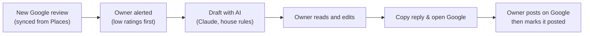

### One seam, one model

All AI calls go through a single interface, `TextGenerator` (`generate(system, prompt, maxTokens, effort)`), with one
production implementation on the official Anthropic PHP SDK and a fake for tests. The model is set in config
(currently Claude Opus 5, `claude-opus-5`). Swapping models or providers touches one class.

- **Effort is sized to the job.** Reply drafts use low effort with up to 4,000 output tokens; insights use medium
  effort with up to 8,000.
- **Failures are ordinary.** A 60 second timeout and two retries. Rate limits, API errors and refusals all come back
  as "no result", and the owner sees a plain "try again in a minute" instead of an error page.
- **Off unless configured.** With no API key, the "Draft with AI" button and the insights refresh simply do not
  appear.

### Guardrails

- **No auto-posting, ever.** RepComet never publishes anything to Google. Every draft is copied and posted by the
  owner, who stays responsible for what goes out under the business's name.
- **The same compliance rules as the rest of the product.** The drafting instructions forbid offering money, discounts
  or gifts in connection with a review, asking anyone to change or remove a review, and asking anyone for a review
  or a rating. That matches the product's no-review-gating rule.
- **Nothing it was not told.** Drafts may only respond to what the reviewer wrote: no prices, addresses, job details,
  other customers or private information. They use the reviewer's first name only, and only when Google provides one.
- **Less data in.** Insights send only review text, star ratings and private feedback text. Customer names, phone
  numbers and email addresses are not sent, and the instructions forbid naming or quoting individual customers.
- **Checked on the way out.** Every response is cleaned to the house style (for example, no em dashes or wrapping
  quotes). Insights must come back as a JSON object, which is parsed defensively: missing parts become empty, and
  text that is not JSON becomes the summary rather than an error.

### Cost control

- Every call records its own cost in millionths of a dollar, from the input and output token counts and the model's
  list price (set in config), next to the tenant's other usage, so AI spend per business is always visible.
- **Allowances per plan:** Solo includes 30 AI reply drafts a month. Growth and Pro are unlimited in practice but held
  to a fair-use ceiling of 1,000 a month, so a runaway script cannot run up a bill.
- **Insights refresh at most once a day,** and only once there are at least 3 reviews or comments to read.
- Drafts stop when a trial or plan has ended, with a clear reason.

### Tested without calling the API

The test suite binds the fake generator, so no test ever calls a live model or needs a key. Seven focused tests cover:

- house-style cleaning, and metering with cost;
- the Solo monthly allowance;
- no key meaning no button and a clear message;
- the review editor filling in the draft;
- insights JSON parsing and the once-a-day refresh;
- the minimum-feedback and plan rules;
- tenant isolation of insights.

They run on every pull request in CI with the rest of the suite.

> RepComet's website chat comes from a sister product, Chattiv, whose optional AI assistant answers visitors from
> the business's own content and hands off to a person. Its case study is at
> [nvitguru/chattiv-casestudy](https://github.com/nvitguru/chattiv-casestudy).

---

## The product

<p align="center">
  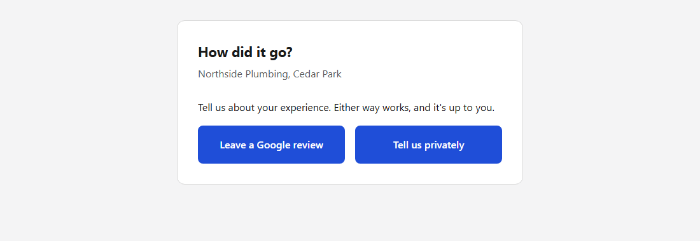
</p>

| | |
|---|---|
| **Review requests** | After a job is marked complete (by hand, CSV import, or Zapier and the API), one text a couple of hours later and at most one email follow-up, only in the business's sending hours and its own timezone. Never more than two messages; never the same customer twice in 30 days. |
| **The choice page** | One page with two buttons of equal size and weight. Google goes straight to the business's Google review dialog; private feedback lands in the owner's inbox with an instant alert. |
| **Google reviews** | Ratings and new reviews synced from Google Places, alerts for new reviews with low ratings first, reply drafting (with AI help) and a "copy and open Google" flow. |
| **Your own wording** | Owners write their own texts and emails, with a linter that refuses wording that breaks the rules: incentives, asking for five stars, "only if you were happy", link shorteners. |
| **Texting by Texttive** | Each business gets its own toll-free number, set up and registered with the carriers through a sister product's partner API, with email covering the gap until approval. |
| **Website chat by Chattiv** | Pro plans include live chat on the business's own website through another sister product, with one-click sign-in from RepComet. |
| **Growth tools** | Satisfaction surveys, a referral program, a team leaderboard, AI review insights and competitor tracking. |
| **Pre-signup check** | Before an account exists, a business finds its own Google listing and confirms the basics (US based, customer permission, no gating, carrier details), so nobody pays for a tool they cannot use. |
| **Help center** | 19 guides and 26 FAQs inside the app, with prices and allowances read from the same billing config the checkout uses. |

<p align="center">
  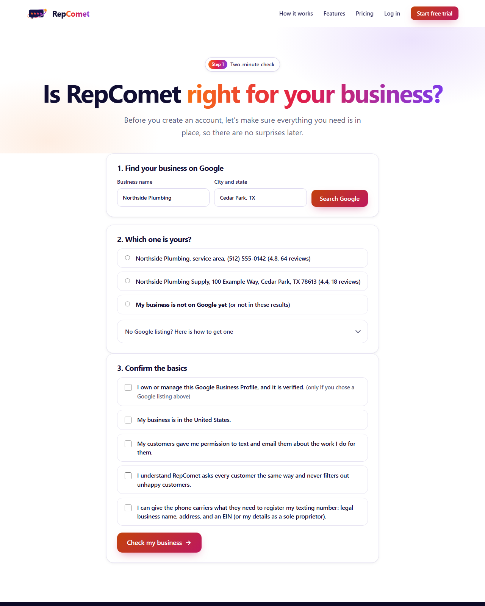
</p>

<p align="center">
  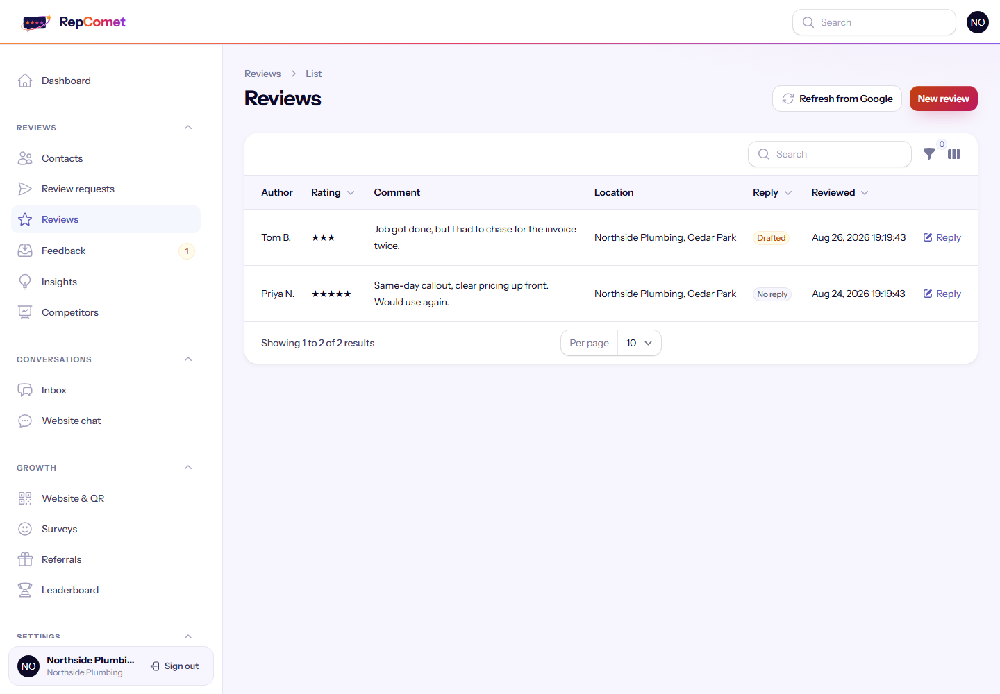
</p>

---

## Architecture

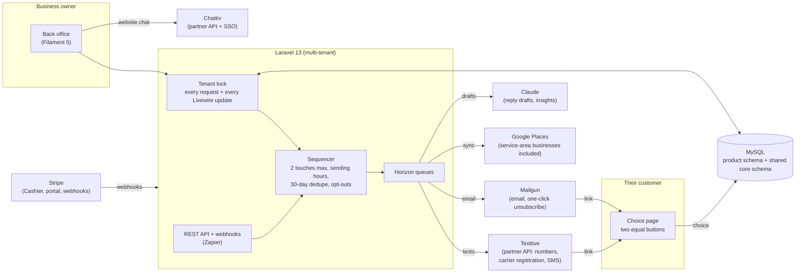

One Laravel application serves the marketing site, the owner back office, the staff admin and the public API.
Product data lives in its own schema; tenants, billing and usage live in a shared "core" schema used across the
portfolio. Horizon runs the sequencer, Google syncs, texting setup and alerts; nothing slow ever runs inside a
customer's or owner's request.

---

## Engineering highlights

### 1. Compliance is the product, enforced in code

The rules that keep a business safe are not settings an owner can switch off:

- **No review gating.** Every customer gets the same request. The choice page asks nothing before the choice and
  shows both options with equal prominence. The same rule covers the public review page, QR cards and the widget.
- **Wording that cannot break the rules.** A template linter rejects incentives, star-rating requests, "if you were
  happy" phrasing, steering unhappy customers away from Google, link shorteners and any link but the review link.
- **TCPA opt-out.** "Reply STOP to opt out" is appended to every text and cannot be removed. STOP and the email
  unsubscribe (with RFC 8058 one-click) opt the person out of every channel at every location, permanently, and
  cancel anything already queued.

### 2. Multi-tenant isolation, including Livewire

Every tenant-owned model is scoped through a context that is **locked** for the request, so no caller can widen
it. While building a support feature, a test that replays a real Livewire update request showed that background
requests (search, sort, paging, table actions) were not running the lock. The fix was to make the auth and
tenant-lock middleware persistent, and the test now guards it:

```php
// Simplified: replay a real Livewire update with a fresh (empty) tenant context.
$res = $this->postJson('/livewire/update', ['components' => [[
    'snapshot' => $contactsTableSnapshot, 'updates' => [], 'calls' => [['method' => '$refresh']],
]]]);

$this->assertStringContainsString('Alice (my customer)', $res->getContent());
$this->assertStringNotContainsString('Bobby (another business)', $res->getContent());
```

It was found and fixed before any business owner had an account in production.

### 3. Staff can see what owners see, without being able to change it

Support staff can open any business's back office in a read-only "view as" mode, with no owner login needed. The staff
account is cloned in memory and attached to the business for that request only, Livewire calls are limited to
browsing (paging, sorting, filters), other requests must be GET, and every database save is cancelled as a
backstop. Every view is written to the business's audit log.

### 4. A sequencer that respects people's evenings

Each job gets at most two touches, timed from when the job finished, only inside the location's sending window
(9 AM to 8 PM by default, in that location's timezone). A message due overnight waits for the morning instead of
being skipped. Choosing either button cancels any follow-up, and the system holds messages rather than sending
them when a trial ends or a plan lapses.

### 5. Google, including businesses with no address

Most home-service companies list a service area on Google instead of a street address, and Google's Places Text
Search leaves those out unless asked. That is how a real fence company could not find its own listing during
setup. RepComet asks for service-area businesses explicitly and labels them with their phone number, so owners
can recognise their listing:

```php
Http::post('https://places.googleapis.com/v1/places:searchText', [
    'textQuery' => $query,
    'regionCode' => 'US',
    'includePureServiceAreaBusinesses' => true,
]);
```

### 6. Texting through a sister product's partner API

Each business gets its own toll-free number. RepComet creates a sub-account under its own parent account in
Texttive, buys the number, pre-fills the carrier verification from the owner's answers, and lets staff review it
before it is filed. Approval takes days, so email covers review requests in the meantime, and owners can turn
texting on later from their settings.

### 7. Billing that cannot drift from the site

Prices, allowances, seats and AI limits live in one config file. The pricing page, the plan cards, the help guides,
the trial emails, and the script that creates the Stripe catalog all read from it. That script reads the config
from the deployed server, puts the amount in each Stripe lookup key so a price change creates a new price, and has
a read-only check mode for a dry run before anything is written.

### 8. Backups that have been restored

Nightly dumps of both schemas are verified (valid gzip, sane size, mysqldump's completion marker), uploaded to
private object storage and pruned (30 daily copies plus 12 monthly). The restore command refuses the live databases
unless explicitly forced, and the restore procedure was tested end to end: every table and row count matched.

---

## More of the product

<p align="center">
  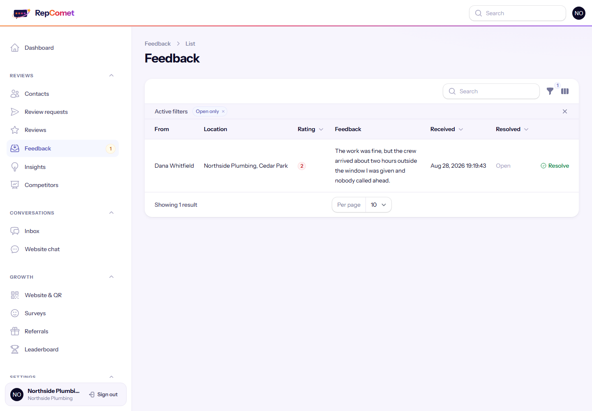
</p>

<p align="center">
  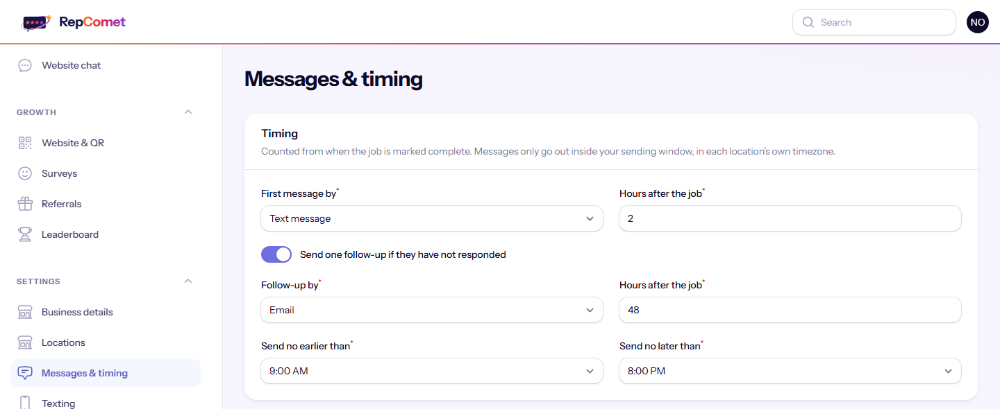
</p>

<p align="center">
  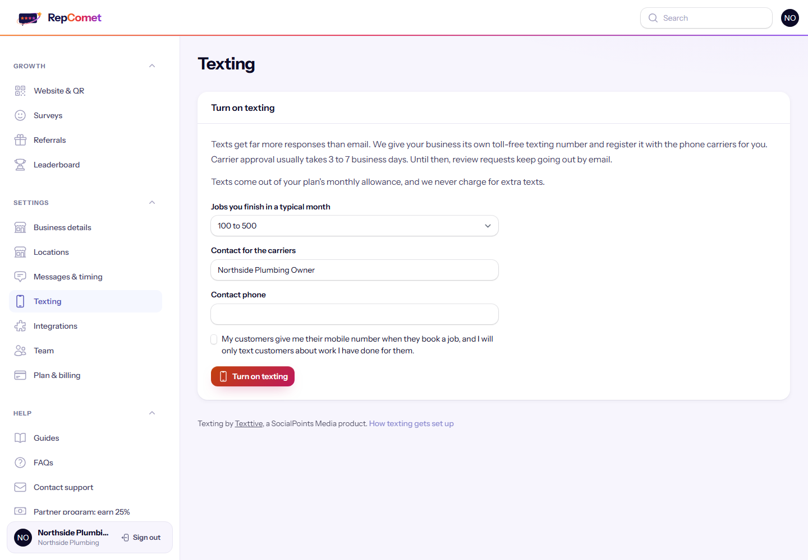
</p>

<p align="center">
  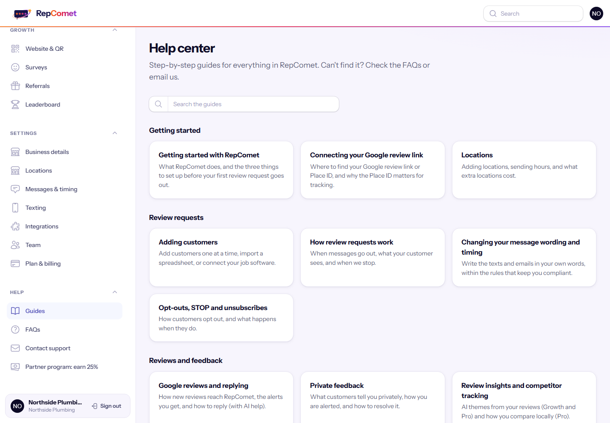
</p>

<p align="center">
  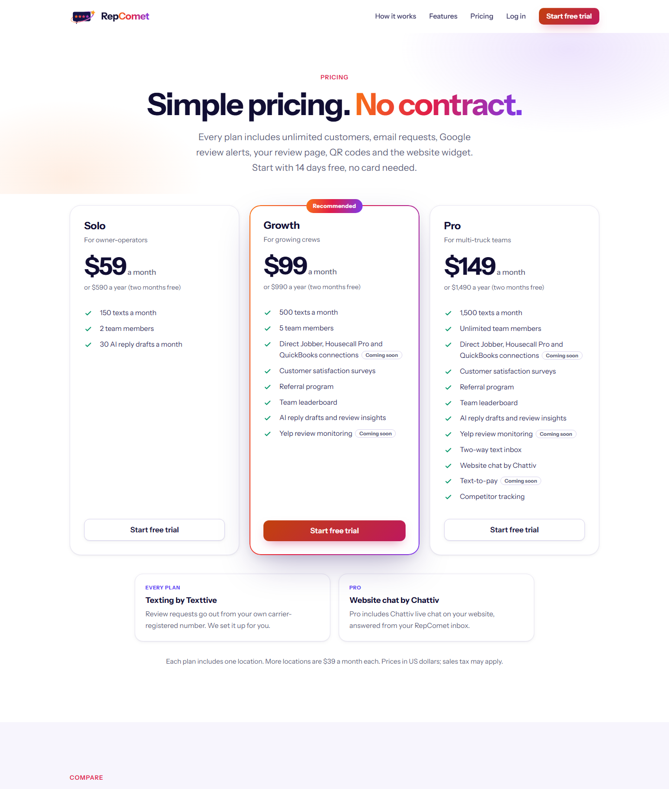
</p>

---

## Quality and safety

- More than 720 automated feature tests, covering the review sequence and its timing, compliance (the template
  linter, opt-outs, the equal-prominence choice page), tenant isolation (including replayed Livewire requests),
  staff view-as, billing and Stripe webhooks, Google sync, texting setup through the partner API, backups and
  restores, the eligibility check, the help center content and admin alerts.
- The test bootstrap refuses to run against anything but dedicated test schemas, and a dedicated test proves the
  real schemas were never touched.
- Continuous integration on GitHub Actions: PHP 8.4 as in production, throwaway MySQL and Redis services, a full
  asset build and the whole suite, in about two minutes per run.
- Every change ships through a pull request with a written report, and every deploy keeps the previous releases
  for a one-command rollback.
- No em dashes in customer-facing copy, and no feature is advertised before it exists: unbuilt items are labelled
  "Coming soon".

## Tech stack

**Backend:** PHP 8.4, Laravel 13, Filament 5, MySQL 8, Redis, Horizon, Cashier (Stripe), Mailgun, Google Places
API (New), Anthropic Claude (reply drafts and insights).
**Frontend:** Blade, Livewire, Tailwind CSS (marketing site and a custom Filament theme).
**Operations:** zero-downtime release folders with rollback, nightly off-site backups, GitHub Actions CI.

## My role

I was the project manager for RepComet: I defined the product and its compliance rules, set the priorities and
pricing, ran acceptance testing, am running the first pilot, and directed the build from first commit to production.

---

<p align="center">
  RepComet is a product of SocialPoints Media LLC. Source available to reviewers on request.<br>
  <a href="https://repcomet.com">repcomet.com</a>
</p>
